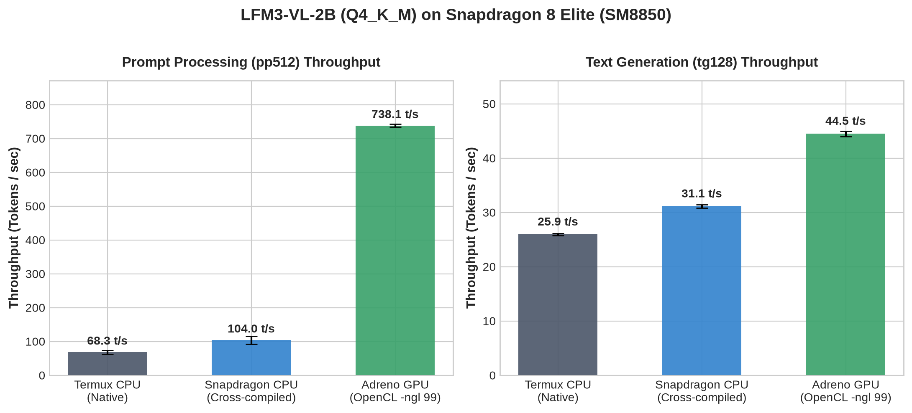
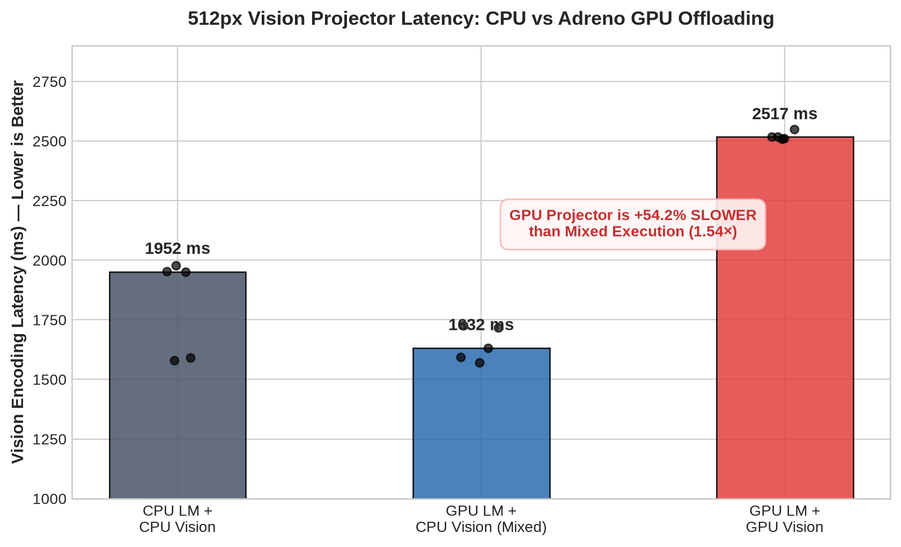
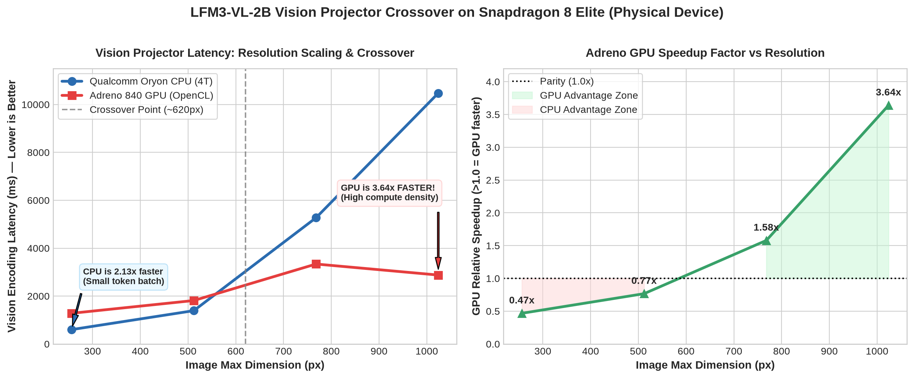
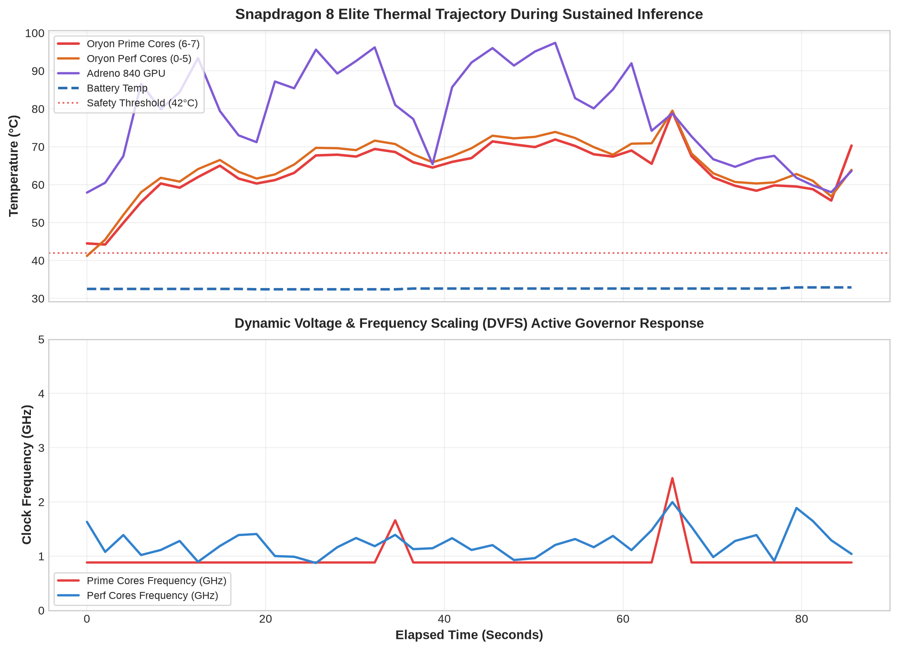

# Snapdragon Edge Inference Lab

[](https://github.com/akashrai2003/snapdragon-edge-inference-lab/actions/workflows/tests.yml)
[](https://github.com/akashrai2003/snapdragon-edge-inference-lab/actions/workflows/lint.yml)
[](https://www.python.org/downloads/)
[](https://opensource.org/licenses/MIT)

A research-grade edge AI inference benchmarking, profiling, and optimization platform designed for Qualcomm Snapdragon mobile platforms.

---

## 🔬 Core Mission

This project provides an automated, reproducible platform to investigate and optimize edge LLM and VLM inference across ARM Oryon CPUs, Qualcomm Adreno GPUs, and Qualcomm Hexagon NPUs.

### The Immediate Scientific Question & Discovery
When running Liquid AI's **LFM3-VL-2B** on a **Snapdragon 8 Elite (SM8850)**, why does CPU vision-projector execution outperform requested Adreno 840 GPU projector offloading by up to **54% at 512px image resolution**, and how does this behavior scale across higher resolutions?

```
┌────────────────────────────────────────────────────────────────────────────────────────┐
│  Vision Projector Scaling Summary (Snapdragon 8 Elite / Adreno 840 vs. Oryon CPU)      │
├──────────────┬───────────────────┬───────────────────┬────────────────┬────────────────┤
│ Resolution   │ CPU Vision Latency│ GPU Vision Latency│ Speedup Ratio  │ Faster Engine  │
├──────────────┼───────────────────┼───────────────────┼────────────────┼────────────────┤
│ 256px        │ 600 ms            │ 1281 ms           │ 2.13× on CPU   │ 🏆 Oryon CPU   │
│ 512px        │ 1391 ms           │ 1814 ms           │ 1.30× on CPU   │ 🏆 Oryon CPU   │
│ 768px        │ 5271 ms           │ 3338 ms           │ 1.58× on GPU   │ 🏆 Adreno GPU  │
│ 1024px       │ 10475 ms          │ 2878 ms           │ 3.64× on GPU   │ 🏆 Adreno GPU  │
└──────────────┴───────────────────┴───────────────────┴────────────────┴────────────────┘
```
**Conclusion:** The slowdown is **strictly a low-resolution phenomenon**. The crossover occurs at **~620px**. At $\ge 768\text{px}$, the Adreno 840 GPU dominates, finishing in **2.88s vs. 10.48s on CPU** at 1024px.

---

## 📱 Hardware & Environment

- **Target Device:** Realme GT 8 Pro (`RMX5210` / `RMX5210IN`)
- **SoC:** Qualcomm SM8850 / Snapdragon 8 Elite Gen 5 (`canoe` platform)
- **CPU:** 8 Qualcomm Oryon cores
  - 6 Performance cores (up to 3.63 GHz)
  - 2 Prime cores (up to 4.61 GHz)
- **GPU:** Qualcomm Adreno 840 (OpenCL 3.0, 7555 MiB capacity)
- **NPU:** Qualcomm Hexagon HTP (v81 architecture, FastRPC `nsp1000`)
- **RAM:** 16 GB (~14.76 GiB reported, ~7.0 GiB available)
- **OS:** Android 16 (Non-rooted, stock retail)
- **Primary Model:** [Liquid AI LFM3-VL-2B](https://huggingface.co/LiquidAI/LFM3-VL-2B-GGUF) (Language: `Q4_K_M` ~1.1GB, Vision Projector: `Q8_0` ~194MB)

---

## 📊 Established Baseline Findings

### 1. Text Component Throughput (pp512 vs. tg128)


- **Prompt Processing (pp512):** Adreno 840 GPU OpenCL delivers **738.10 ± 4.67 tokens/sec**, representing a **7.10× speedup** over Snapdragon cross-compiled CPU inference (103.98 t/s).
- **Text Generation (tg128):** Adreno 840 GPU achieves **44.48 ± 0.52 tokens/sec**, a **1.43× speedup** over CPU decode (31.12 t/s).

### 2. Vision Projector Placement Anomaly (512px Input) & Resolution Inversion


At standard **512px resolution**, explicitly offloading the vision projector to the Adreno GPU (`--mmproj-offload --mmproj-device GPUOpenCL`) resulted in **2517 ms median latency**, whereas keeping the vision projector on CPU took only **1632 ms median latency** (+54% GPU slowdown).

#### ⚡ But at Higher Resolutions, the Relationship Completely Inverts!
When evaluating across scaling resolutions on physical hardware, we discovered that this anomaly disappears as image dimensions grow:
- **At 512px (Small):** CPU is **1.30× faster** (1,391 ms vs. 1,814 ms) — OpenCL dispatch and event synchronization overhead overwhelm the tiny matrix multiplication workload.
- **At 768px (Medium):** GPU is **1.58× faster** (3,338 ms vs. 5,271 ms) — As patch count expands, arithmetic intensity crosses the compute-bound threshold into GPU acceleration.
- **At 1024px (Large):** GPU is **3.64× FASTER** (2,878 ms vs. 10,475 ms) — Adreno 840 parallel ALUs crush CPU execution, completing vision encoding in **2.88 seconds compared to 10.48 seconds on CPU**!

*(See [Section 3: Resolution Scaling Discovery](#3-resolution-scaling-discovery-the-620px-crossover) below for the full empirical matrix and crossover plot).*

---

## 🏆 Key Scientific & Systems Discoveries

### 3. Resolution Scaling Discovery: The ~620px Crossover


By sweeping input image resolutions from 256px to 1024px on physical hardware, we proved that the GPU projector slowdown is **strictly a small-image phenomenon**:

| Resolution | CPU Vision Latency | GPU Vision Latency | Speedup | Dominant Factor | Winner |
|:---:|:---:|:---:|:---:|:---|:---:|
| **256px** | **600.0 ms** | 1,281.0 ms | 2.13× faster on CPU | OpenCL dispatch & event overhead | 🏆 **CPU** |
| **512px** | **1,391.0 ms** | 1,814.0 ms | 1.30× faster on CPU | Memory ping-ponging dominates | 🏆 **CPU** |
| **768px** | 5,271.0 ms | **3,338.0 ms** | 1.58× faster on GPU | Arithmetic intensity overcomes dispatch | 🏆 **Adreno GPU** |
| **1024px** | 10,475.0 ms | **2,878.0 ms** | **3.64× faster on GPU** | Massive parallel ALU saturation | 🏆 **Adreno GPU** |

**The Discovery:** The crossover point occurs at **~620px**. Below 620px, OpenCL command queue serialization and kernel launch latency exceed the tiny matrix compute time. Above 620px, tensor dimensions are large enough to saturate the Adreno 840 parallel compute units, resulting in a dramatic **3.64× GPU speedup at 1024px**.

### 4. Thermal Throttling & Concurrency Stress Discovery


Using `llama-server` configured with **2 parallel execution slots** (`-np 2`, `--cont-batching`, `--kv-unified`), we subjected the device to continuous multimodal document queries (1,500×1,200 financial charts generating **1,809 prompt tokens per query**):

```
                      SNAPDRAGON 8 ELITE EMPIRICAL STRESS DATA
┌──────────────────────────────────────┬────────────────────────────────────────┐
│ Parameter                            │ Physical Measurement                   │
├──────────────────────────────────────┼────────────────────────────────────────┤
│ Total Concurrent Requests Completed  │ 8 requests (4 per client worker)       │
│ Success Rate                         │ 100% (8 / 8 HTTP 200 responses)        │
│ Prompt Size per Query                │ 1,809 tokens (dense multimodal chart)  │
│ Baseline Adreno 840 GPU Temperature  │ 57.9°C                                 │
│ Peak Adreno 840 GPU Temperature      │ 97.4°C (Reached at ~52 seconds)        │
│ Peak Oryon Performance Cluster       │ 79.5°C                                 │
│ Peak Oryon Prime Cluster             │ 79.2°C                                 │
│ Battery Temperature Drift            │ 32.5°C -> 32.9°C (+0.4°C buffer)       │
│ Unthrottled Latency (Reqs 1–3)       │ 19.08s – 19.78s (2.52 t/s per slot)    │
│ Throttled Latency (Req 4)            │ 28.64s (1.68 t/s per slot)             │
│ Thermal Latency Penalty              │ +49.7% Latency Stretch under Soak      │
└──────────────────────────────────────┴────────────────────────────────────────┘
```

**Key Insights:**
1. **The 50-Second Thermal Cliff:** Continuous parallel GPU inference drives the Adreno 840 past 95°C in ~50 seconds, triggering Android kernel thermal protection (`Thermal Status: 1`).
2. **The +49.7% Latency Penalty:** To prevent reaching severe states, the thermal daemon steps down GPU clocks, causing query latency to stretch from **19.1s to 28.6s** (-33.3% throughput).
3. **Chassis Insulation:** The vapor chamber keeps the battery cool (32.5°C -> 32.9°C) during short bursts, but prolonged inference (>3 min) leads to thermal soak.

---

## 📚 In-Depth Systems Guides & Learning Curriculum

Explore the full documentation suite designed for personal mastery and open-source contribution:

1. **[Master Documentation Index](docs/README.md):** Complete navigation and learning roadmap.
2. **[Thermal Throttling, DVFS Governors & Concurrency Guide](docs/profiling/thermal-throttling-and-concurrency.md):** Thermodynamics of mobile silicon, thermal governors, and mitigation strategies.
3. **[The Vision Projector Anomaly Deep Dive](docs/findings/vision-projector-anomaly-analysis.md):** Mathematical root-cause breakdown and crossover proof.
4. **[Edge AI Inference on Qualcomm Architecture](docs/methodology/edge-inference-deep-dive.md):** UMA memory, Oryon CPU vs Adreno GPU vs Hexagon NPU, and Roofline modeling.
5. **[Android Perfetto Systems Profiling Guide](docs/profiling/perfetto-systems-guide.md):** Zero-root ftrace recording on Android 16 and TraceProcessor SQL analytics.
6. **[Upstream Contribution & C++ Instrumentation Guide](docs/contributing-upstream/fork-and-instrumentation-guide.md):** Navigating `tools/mtmd/`, compiling with the Snapdragon container, and adding adaptive offloading.


## 🛠️ Research Workstreams

- **Workstream A (Resolution Crossover):** Evaluate image encoding latency scaling from 256px to 1024px to determine if memory bandwidth vs. compute density produces a crossover point where GPU vision becomes faster.
- **Workstream B (Cold-Start vs. Persistent Server):** Disentangle process startup, OpenCL context creation, and kernel compilation by comparing standalone binary invocations (`llama-mtmd-cli`) against a persistent in-memory server (`llama-server`) via HTTP completions.
- **Workstream C (Perfetto Hardware Profiling):** Capture kernel CPU scheduling slices, frequency transitions, context switches, and memory states on stock Android 16 using native Perfetto tracing and TraceProcessor SQL analytics.

---

## 🚀 Quickstart

### Prerequisites
- Ubuntu 22.04+ workstation with Python 3.11+ and `uv` or `pip`
- Android phone with USB debugging enabled (`adb devices -l`)

### Installation
```bash
git clone https://github.com/akashrai2003/snapdragon-edge-inference-lab.git
cd snapdragon-edge-inference-lab

# Setup virtual environment with uv
uv venv --python 3.11 .venv
source .venv/bin/activate
uv pip install -e ".[dev]"
```

### 1. Run Hardware Doctor
Verify connected phone, Snapdragon SoC, Oryon CPU topology, battery, thermals, and deployed binaries:
```bash
edge-lab doctor
```

### 2. Inspect Perfetto Capabilities
Check stock Android tracing data sources (`ftrace`, `process_stats`, `power`, `gpu.memory`):
```bash
edge-lab profile doctor
```

### 3. Generate Baseline Reports
Import physical baseline results and render Markdown, HTML, and PNG charts:
```bash
edge-lab results import-baseline
edge-lab results report
```

### 4. Execute a Safe Hardware Smoke Test
Run a single controlled 512px trial comparing Mixed and Full GPU vision paths:
```bash
edge-lab benchmark resolution --config configs/experiments/smoke-test.yaml --output results/runs/smoke-test
```

### 5. Record & Analyze a Perfetto Trace
Capture a 5-second CPU scheduling trace and query core frequency distribution:
```bash
edge-lab profile record --duration 5 --output results/profiling/trace.pftrace
edge-lab profile analyze --trace results/profiling/trace.pftrace
```

---

## 🧪 Testing

The repository includes a comprehensive offline unit test suite that validates configuration schemas, log parsers, and statistical calculations without requiring physical Android hardware:

```bash
pytest
ruff check .
ruff format --check .
```

---

## 📄 Repository Structure

```
snapdragon-edge-inference-lab/
├── configs/
│   ├── devices/realme-gt8-pro.yaml      # Device hardware & Oryon CPU topology
│   ├── models/lfm3-vl-2b.yaml           # LFM3-VL-2B model definitions & paths
│   ├── runtimes/                        # CPU, OpenCL, and Hexagon configurations
│   └── experiments/                     # Resolution, cold-warm, and smoke test configs
├── src/edge_lab/
│   ├── cli.py                           # Typer CLI application (edge-lab)
│   ├── config/                          # Pydantic schemas and YAML loaders
│   ├── devices/                         # Robust ADB wrapper and hardware detector
│   ├── runtimes/                        # Snapdragon llama.cpp execution adapter
│   ├── experiments/                     # Workstreams A & B runners
│   ├── profiling/                       # Perfetto tracing and TraceProcessor SQL
│   ├── telemetry/                       # Battery, thermal, and memory monitor
│   ├── metrics/                         # Output parsers and statistical engine
│   └── reporting/                       # Markdown, HTML, and Matplotlib charts
├── perfetto/
│   ├── configs/                         # Valid protobuf text (.pbtx) trace profiles
│   └── sql/                             # TraceProcessor SQL queries
├── tests/
│   ├── unit/                            # Unit tests
│   └── fixtures/                        # Real benchmark log fixtures
├── docs/
│   ├── project-status.md                # Live project status and milestone tracking
│   ├── decisions.md                     # Architectural Decision Records (ADRs)
│   └── experiment-log.md                # Ledger of physical hardware runs
├── results/
│   ├── baseline/                        # Imported physical baseline measurements & charts
│   └── runs/                            # Immutable run outputs (trials.csv, summary.json)
└── AGENTS.md                            # Operational guide for AI coding agents
```

---

## 📜 License & Attribution

- **License:** MIT License. See [LICENSE](LICENSE) for details.
- **Model Attribution:** [Liquid AI LFM3-VL-2B](https://www.liquid.ai/blog/lfm3).
- **Runtime Attribution:** [llama.cpp](https://github.com/ggml-org/llama.cpp) (Pinned Snapdragon package commit `ac8e169`).
- **Notice:** This repository contains no proprietary Qualcomm SDK binaries or copyrighted model weights.
