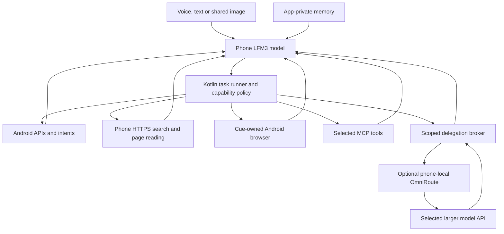

# On-phone orchestration: implementation plan

Status: proposed implementation, informed by the pinned source review. No new runtime capability or benchmark is claimed here.

## Runtime and data flow

The router is a proxy, not the owner of the task. Native tools need no HTTP/MCP server inside the same process. MCP is an adapter for selected tools, not permission to run arbitrary servers or commands. A specialized server can run in Termux on the phone if its dependencies work there; remote MCP is optional and subject to the same data policy.

The local inference client is permanently separate from the delegation client. Local model failure never silently sends the private chat to a cloud fallback. Keep native actions, browser sessions and task persistence usable without an always-on PC or cloud model.

## First code boundaries

| Component | Responsibility | Existing Cue integration |
| --- | --- | --- |
| `AgentModelClient` | Tool schemas, assistant tool calls and tool-result messages; actual GGUF/template compatibility | Extend the protocol beside `AssistantClient`; retain text/vision requests |
| `AgentStreamDecoder` | Reassemble streamed IDs/indexes/names/JSON arguments with byte bounds; emit typed events | Extend/reuse SSE framing in `StreamDecoder`; keep tool syntax and reasoning out of speech |
| `ToolRegistry` | A small executable catalog with parameter validation, permission checks and runtime availability | In-process native tools; MCP adapters use the same call path |
| `TaskRunner` | Bounded decide → validate → execute → observe loop; task ownership, Stop, retries and state | `CueSession` owns task/generation IDs; views observe state |
| `PhoneSearchTools` | Search providers, fetch/extract, provenance, citations and unavailable outcomes | Android HTTPS networking; no desktop worker |
| `PhoneBrowserController` | Visible owned WebView, structured observations and typed actions | Separate user-visible task surface; no microphone lifecycle replacement |
| `DeviceTools` | Native actions, installed-app resolution, contacts/calendar with scoped access | Android APIs and supported intents before UI automation |
| `DelegationBroker` | Explicit subtask construction and code-enforced egress policy | Optional direct compatible API or phone-local router endpoint |
| `TaskStore` | Persisted task/event ownership and unfinished-action state | App-private database; no personal prompts in diagnostics |

Proposed names describe boundaries, not files already shipped.

### Tool and result contract

Each registered tool has a name, bounded JSON input schema, runtime availability, execution target, timeout, data classification, mutation/idempotency semantics, and a code-owned authorization policy. Model output and third-party MCP annotations cannot grant themselves permissions. MCP annotations are descriptive hints, not an enforcement boundary. [MCP tools specification](https://modelcontextprotocol.io/specification/2026-07-28/server/tools).

Each invocation has a task ID, call ID and lifecycle generation. Results distinguish success, unavailable, invalid arguments, needs user input, failed, canceled, and dispatched-without-confirmation. Add structured evidence such as a source URL, a confirmed app state, or a created record ID. A successful `startActivity` only proves dispatch; do not claim a message was sent or an event was created without the corresponding result.

Read operations can use bounded retries. Writes require request deduplication and postcondition checks; an ambiguous outcome cannot be blindly repeated. Only the runner executes calls, after full argument validation. Partial SSE arguments and quoted tool text in a web page are never executable instructions.

## Phone-only search

1. Introduce `web_search(query, freshness, limit)` and `web_read(url, max_chars)` with a provider-independent result format. All network execution originates on the phone.
2. Evaluate lightweight keyless providers on the actual phone network; port small request/extraction ideas where suitable. DDGS depends on `primp` and `lxml`, so its package is not assumed Android-compatible. Prefer an Android client over a mandatory Python service for simple HTTPS.
3. Cache public responses by query/provider/freshness, deduplicate URLs, honor throttling and show partial-provider errors. No search quota is imposed by Cue, but providers can restrict requests. Do not rotate identities or bypass site challenges to manufacture an “unlimited” claim.
4. Fetch actual source pages, cap compressed/decompressed bytes and extracted text, validate redirects and public destinations, and preserve source/retrieval metadata. Web content is untrusted evidence, not system instructions or permission to call another tool.
5. Use the phone browser for JavaScript or user interaction. Add optional API-key providers or a configured SearXNG endpoint later. No public SearXNG instance becomes a mandatory dependency.
6. Answer with sources and a visible Open source action; spoken output stays natural and does not read raw URLs. If retrieval fails, state that current information is unavailable.

## Browser on the phone

Build an owned WebView controller instead of requiring Node/Playwright plus a desktop Chromium process. Use Playwright's **observations and action contracts** as the reference, not an assumption that its runtime runs natively inside an Android app. `evaluateJavascript` can implement app-owned DOM observation and a fixed action vocabulary. The model supplies typed arguments, not arbitrary JavaScript. [Android WebView API](https://developer.android.com/reference/android/webkit/WebView).

Expose `browser_open`, `browser_observe`, `browser_activate`, `browser_type`, `browser_scroll`, `browser_back` and `browser_extract`. Observations contain a navigation/snapshot ID, current origin, a compact set of visible roles/labels and native-owned element references. Reject stale references, changed origins and ambiguous targets. After an action, wait for a bounded page transition and observe again before claiming success.

Use semantic observations first and the phone's vision model for visual fallback. Keep login/cookies in the phone browser; do not export them to the LLM/router. User login, passkeys, unsupported embedded-browser sites, cross-origin frames, file downloads and external app links need compatibility tests and an explicit handoff path. Arbitrary control of the user's Chrome session is a different capability; an owned WebView does not provide it automatically.

Keep the WebView's JavaScript-to-native boundary narrow: no general native command bridge exposed to remote pages, no model-generated JavaScript, and no page access to local model/control endpoints or private file/content URLs. Remote page text never authorizes a native action. Native-to-page observation/action scripts return bounded structured data and are tied to the current navigation generation.

Visible Android/browser automation runs while the user is interacting and the relevant screen is available. If the device locks or Android stops the task, persist and resume or ask for the needed user input. Do not promise that a hidden browser keeps operating indefinitely while the phone sleeps.

## Native apps and visual context

Start with app opening, maps/navigation, timers/alarms, calendar/dial/message drafts, sharing and explicit contact lookup. Resolve installed capabilities and ambiguous names before invoking them. Default to the narrowest relevant Android API or intent; do not expose an arbitrary shell or general Intent construction to the model.

Cue already accepts shared images and sends them to the installed vision model. Screenshot → Share → Cue is the immediate explicit screen-understanding path. Next evaluate a user-selected assistant role with `VoiceInteractionService`/`VoiceInteractionSession` and assist/screenshot callbacks; availability depends on user settings, app security and platform behavior. MediaProjection is a separate consented capture-session path, not a reusable silent screenshot permission. [Assistant session API](https://developer.android.com/reference/android/service/voice/VoiceInteractionSession), [MediaProjection](https://developer.android.com/media/grow/media-projection).

General app UI automation is an optional research/sideload build. Reuse the snapshot-ID/ref and serialization patterns in OpenClaw's third-party Android implementation, and study Mobilerun's guarded accessibility traversal. Respect secure windows, user navigation and current task ownership. Do not port permission auto-accept helpers. The Play distribution constraint is recorded in the overview and must not be hidden by claiming a general assistant is a disability-focused accessibility tool.

## Larger models and OmniRoute

Use the local model for ordinary orchestration, simple reasoning, tool selection, personal context and final answers. Permit an optional `delegate_public_task` capability for difficult public research, code or explicitly shareable reasoning. The phone model receives the result and decides the next action. Remote advice is validated like other untrusted tool output and cannot directly operate the phone.

The delegation broker constructs a minimal payload from explicitly allowed fields. Contacts, notification text, personal memory, account pages, cookies, screenshots and private chat are local-only by default. Sensitivity labels come from data sources and code policy, not just a model's opinion or a redaction regex. A mixed private/public task stays local unless the user deliberately chooses the specific data to share. The UI can say “Use a stronger model” and explain the included material; technical provider settings stay in Settings.

OmniRoute is a useful **optional phone-local gateway**: the pinned revision documents Termux support, OpenAI-compatible endpoints, native dependency requirements and quota/failure routing. Qualify it in an isolated Termux setup before adopting it. Measure installation/native-build success, idle and per-request memory/CPU/battery cost, startup latency, cancellation and background survival alongside the local model. Its documentation is evidence of intended support, not a test on this phone. [Pinned Termux guide](https://github.com/cheaper-inference/OmniRoute/blob/82f60e5ef66cb8f4fd92929a44c3679ef844f84a/docs/guides/TERMUX_GUIDE.md).

Keep the private inference endpoint outside all cloud combos. Cloud delegation uses a separate endpoint/profile containing only explicitly enabled, currently eligible providers. Free-only mode must stop at exhaustion instead of silently falling back to a billable route. API keys, provider eligibility and quotas are supplied/controlled by each provider; the router does not grant tokens or guarantee perpetual free availability.

Review logging and caching before routing anything personal: the inspected request logger can capture raw request/response and stream payloads, and its disabled-logging path still sets up stream capture unless that is separately disabled. This does not establish that every deployment logs every request, but it rules out assuming that “local proxy” means “no prompt capture.” Initial delegation should contain public task data only. A small native compatible-provider client remains an alternative if the full gateway's footprint is not worthwhile.

## Memory, workflows and performance

- Store explicit, user-visible preferences and facts in app-private storage with provenance, edit/delete and retrieval budgets. Avoid automatic cloud sync or unbounded memory growth; Letta's memory limits and ownership are useful patterns.
- Workflows use typed steps and saved task state, not a single huge prompt. Scheduled tasks use Android scheduling facilities and account for delayed/background execution. UI steps pause until the required app/screen is available. Use native clock/calendar integrations where exact user alarms are needed.
- Select a few relevant tool schemas per turn. The current runtime script defaults to a 4,096-token context and the current client uses character-based history bounds; exact prompt/token budgeting becomes necessary when schemas, web pages and images share that context. Do not dump a browser tree or hundreds of MCP tools into a 2B model.
- Serialize phone UI mutations. Permit a small bounded number of independent public reads. Start browser/native workers on demand and close idle resources. Do not keep a browser/Node daemon alive merely because voice wake is enabled.
- Stop/End invalidates task generations and cancels model/network/browser work. No queued tool, stale model response or delayed background retry may continue mutating the phone after cancellation. Completed external actions remain visible as completed; cancellation does not claim to undo them.
- Preserve quiet microphone ownership while adding browser/task surfaces. Cue's current base activity holds `AudioGate` while resumed; blindly inheriting it for the browser would pause wake there. Test the intended wake/interrupt path during browsing, task transitions and spoken progress, and release ownership only when the actual voice owner ends.
- Record timings, tool names, success/failure, local/cloud decision origin and aggregate counts without private payloads. Distinguish deterministic native routing from local-LLM decisions and cloud advice in the demonstration. No new latency/battery/accuracy result is claimed by this plan.

## Delivery order and gates

| Milestone | Deliverable | Evidence required before enabling |
| --- | --- | --- |
| 0. Local tool protocol | Correct GGUF/template handling, bounded streamed tool calls, schema validation, dry-run registry | Run the evaluation cases against the actual phone model. Confirm valid calls, tool-result continuation, no invented tools and no premature speech of tool syntax. Record failures, model/template/runtime revisions and real timings. |
| 1. Grounded web answers | Phone `web_search`/`web_read`, citations, provider errors and browser handoff | Real benign searches on the phone; source URLs support claims. Test throttle, challenge, timeout, redirect and unavailable cases. No paid API or PC required. |
| 2. Useful native actions | Open app, maps, timers/alarms, calendar/dial/message drafts with narrow inputs | Validate supported installed apps, missing permissions, ambiguous contact/app names, dispatch versus verified completion, cancellation and duplicate delivery. |
| 3. Own-browser tasks | WebView observations, fresh refs, bounded action loop and user handoff | A controlled mobile test site: navigate, extract, fill, scroll, changed DOM, cross-origin navigation, stale ref, login handoff and Stop. No real purchase/message is used as a test fixture. |
| 4. Screen context | Existing image Share plus optional assistant-role capture | User-invoked capture and local understanding; test secure/unavailable context, dismissal and microphone handoff. Existing wake flow must remain stable. |
| 5. Optional bigger-model help | Scoped broker, selected API profile, optional pinned OmniRoute on phone | Payload inspection proves local-only data is absent; test exhausted quotas, no paid fallback, provider outage, Stop, and return of control to the phone model. Profile gateway costs separately. |
| 6. Richer app workflows | Research accessibility flavor, explicit memory and resumable routines | Test against chosen apps and controlled screens, enforce snapshot/task ownership and distribution constraints, measure end-to-end success and battery use. |

Milestones describe dependencies rather than calendar estimates. Rich UI automation and remote delegation do not block the first phone-only search/native-action demo. Compatibility spikes may reorder browser versus screen-context work.

The initial cases in `evaluation_cases.json` are an **unexecuted specification**, not passing tests. Add varied wording, language/accent-derived transcripts, invalid tool output, prompt injection and interrupted sessions when implementing the harness. Define success targets before running the evaluation and publish actual counts instead of assuming tool support implies reliable autonomous behavior.
