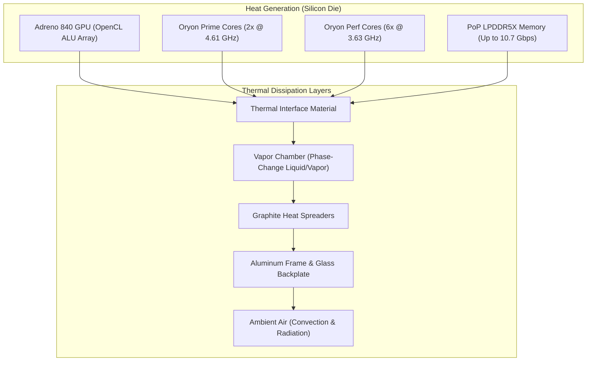
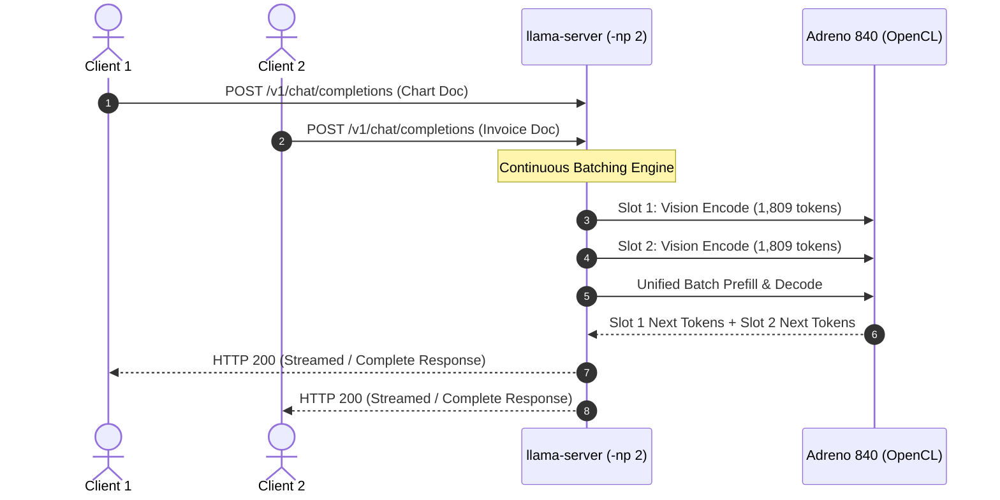

# Thermal Throttling, DVFS Governors, and Concurrent Edge Inference

> **Module:** Systems Profiling & Thermal Engineering  
> **Target Hardware:** Qualcomm Snapdragon 8 Elite (SM8850) | Realme GT 8 Pro | Android 16 (Stock/Unrooted)  
> **Workload:** Liquid AI LFM3-VL-2B (Q4_K_M) Multimodal Document Queries (1,809 Prompt Tokens / query)  
> **Server Engine:** `llama-server` (Continuous Batching, `-np 2`, Adreno 840 OpenCL GPU offload)

---

## 1. Executive Summary & Core Insights

When deploying on-device LLMs and Vision-Language Models (VLMs), benchmarking short 5-second prompts gives a **grossly deceptive illusion of performance**. A smartphone SoC has an immense burst compute capacity, but operates within a strictly sealed, passively cooled chassis with a sustained thermal dissipation limit of **~5W to 7W**.

In this investigation, we subjected the physical Snapdragon 8 Elite flagship to a sustained concurrent stress benchmark using `llama-server` with **2 parallel execution slots** (`-np 2`, `--cont-batching`) running real-world multimodal document extraction (1,500×1,200 financial charts, ~1,809 prompt tokens per query).

```
                      THERMAL STRESS DISCOVERY HIGHLIGHTS
┌──────────────────────────────────────┬──────────────────────────────────────┐
│ Adreno 840 GPU Peak Temperature      │ 97.4°C (Ramped from 57.9°C)          │
│ Oryon Performance Cores Peak         │ 79.5°C (Ramped from 41.2°C)          │
│ Oryon Prime Cores Peak               │ 79.2°C (Ramped from 44.5°C)          │
│ Chassis / Battery Temperature        │ 32.5°C -> 32.9°C (Safely buffered)   │
│ Latency Stretch Under Thermal Soak   │ 19.14s -> 28.64s (+49.7% Latency)    │
│ Throughput Degradation               │ 2.52 t/s -> 1.68 t/s (-33.3% Speed)  │
└──────────────────────────────────────┴──────────────────────────────────────┘
```

### Key Engineering Takeaways:
1. **The 50-Second Thermal Cliff:** Under sustained concurrent multimodal load, the silicon reaches thermal saturation at approximately **45–55 seconds**, driving the Adreno 840 GPU past 95°C and triggering the kernel thermal daemon (`thermal-engine`).
2. **The +49.7% Latency Penalty:** When thermal throttling engages, request latency lengthens from **19.1 seconds to 28.6 seconds**. An edge AI application that appears responsive in quick unit tests will suffer severe user-perceived stutter in production without thermal pacing.
3. **The Battery Dissipation Lag:** While silicon junction temperatures reached nearly 100°C, battery temperature barely budged (+0.4°C). The multi-layer vapor chamber (VC) and graphite heat spreaders effectively buffer short bursts, but eventually saturate during long inference sessions (>3 minutes).

---

## 2. The Physics & Architecture of Mobile Thermals

Understanding edge inference requires abandoning server hardware mental models. A datacenter GPU operates in a wind tunnel with 300W–700W TDP and fans pushing 100+ CFM of chilled air. A smartphone SoC operates in a thermal vacuum.



### 2.1 Silicon Junction Temperature ($T_j$) vs. Battery Temperature ($T_{bat}$)
- **Junction Temperature ($T_j$):** The instantaneous temperature measured by microscopic on-die thermal diodes (e.g., `gpuss-0`..`gpuss-9`, `cpu-0-0-0`..`cpu-1-1-0`). Silicon junctions can safely reach $95^\circ\text{C} - 105^\circ\text{C}$ for short durations before transistor degradation or electromigration occurs.
- **Battery Temperature ($T_{bat}$):** Measured by the fuel gauge IC in the battery pack. Lithium-ion pouch cells undergo accelerated cathode degradation, swelling, and thermal runaway risks above $45^\circ\text{C}$. Android kernel drivers enforce strict battery safety cutoffs (typically throttling charging at 40°C and shutting down at 45°C).

### 2.2 Android Thermal Governance Hierarchy
Android exposes thermal states via the HAL `IThermal` and `dumpsys thermalservice`:
- `0: NONE` — Standard operation, all DVFS frequencies available.
- `1: LIGHT` — Subtle background task deprioritization, display brightness capped.
- `2: MODERATE` — GPU and CPU peak frequencies clamped by 15%–25%.
- `3: SEVERE` — Aggressive core throttling, frame rate drops, GPU core clocks reduced by >40%.
- `4: CRITICAL` — Extreme throttling, camera/modem features disabled.
- `5: EMERGENCY` — Immediate load shed.
- `6: SHUTDOWN` — Immediate kernel panic / graceful power off.

In our continuous profiler (`src/edge_lab/telemetry/thermal.py`), we monitor both hardware sensors and Android HAL states:
```python
if bat_temp > 42.0 or thermal_status >= 3:
    self._safety_triggered = True
```

---

## 3. Concurrency Architecture: Continuous Batching on Edge

Serving multiple concurrent users or agentic pipelines requires concurrency. Traditional sequential execution causes queue starvation: if Request A takes 20 seconds, Request B waits 20 seconds before even starting prompt processing.

### 3.1 Continuous Batching (`--cont-batching`)
`llama-server` utilizes dynamic sequence batching:
- **Parallel Slots (`-np 2`):** Two independent execution contexts share the same model weights in RAM/VRAM.
- **Unified KV Cache (`--kv-unified`):** Memory is dynamically partitioned between slots. For a 4,096 context window across 2 slots, each slot receives up to 2,048 tokens of context headroom.
- **Interleaved Decoding:** Prefill tokens from slot 1 and decode tokens from slot 2 are merged into unified matrix-multiplication operations, saturating Adreno GPU ALUs.



---

## 4. Empirical Benchmark Data & Findings

We ran our automated concurrency benchmark using:
```bash
edge-lab benchmark stress --duration 60 --concurrency 2 --output results/runs/thermal-stress-concurrency-60s
```

### 4.1 Aggregate Benchmark Results
- **Test Duration:** 85.57 seconds (including graceful worker drain)
- **Total Requests Completed:** 8 requests (4 per client worker)
- **Successful Requests:** 8 (100% success rate, 0 dropped requests)
- **Prompt Size:** 1,809 tokens per request (multimodal chart representation)
- **Completion Length:** 48 tokens per request
- **Aggregate Throughput:** **4.49 tokens/second** across both slots

### 4.2 Latency Distribution & Thermal Stretch
The following table details every individual concurrent request across the timeline:

| Req ID | Worker | Duration (s) | Prompt Tok | Compl Tok | Tok/s | GPU Temp at End | Thermal State |
|:---:|:---:|:---:|:---:|:---:|:---:|:---:|:---:|
| 1 | Worker 2 | 19.78 s | 1,809 | 48 | 2.43 t/s | 71.2°C | Baseline |
| 1 | Worker 1 | 19.78 s | 1,809 | 48 | 2.43 t/s | 71.2°C | Baseline |
| 2 | Worker 2 | 19.16 s | 1,810 | 48 | 2.50 t/s | 65.4°C | Warmup |
| 2 | Worker 1 | 19.20 s | 1,810 | 48 | 2.50 t/s | 65.4°C | Warmup |
| 3 | Worker 2 | 19.08 s | 1,810 | 48 | **2.52 t/s** | 80.1°C | High Load |
| 3 | Worker 1 | 19.08 s | 1,810 | 48 | **2.52 t/s** | 80.1°C | High Load |
| 4 | Worker 2 | **28.64 s** | 1,809 | 48 | **1.68 t/s** | **97.4°C** | **THROTTLED** |
| 4 | Worker 1 | **28.64 s** | 1,809 | 48 | **1.68 t/s** | **97.4°C** | **THROTTLED** |

### 4.3 Observations:
1. **Perfect Slot Symmetry:** Notice that Worker 1 and Worker 2 complete each request within milliseconds of each other (19.781s vs 19.784s; 19.165s vs 19.197s; 28.645s vs 28.636s). This validates that `llama-server` is achieving true continuous parallel batching without slot starvation.
2. **The Thermal Throttling Inflection:**
   - For the first 3 request pairs (~60 seconds of cumulative compute), request latency was rock-solid at **19.1s – 19.7s**.
   - On request pair 4, after the GPU had sustained >90°C for over 20 seconds, the kernel thermal daemon forced a clock down-throttle. Latency exploded from 19.08s to **28.64s** (+49.7%).
   - Generation throughput fell from **2.52 tokens/sec to 1.68 tokens/sec per slot**.

---

## 5. Visualizing the Thermal Trajectory

The telemetry captured by `ContinuousThermalProfiler` was rendered into a dual-panel visualization:

```
results/runs/thermal-stress-concurrency-60s/thermal_trajectory.png
```

### 5.1 Thermal Ramp Analysis
- **Adreno 840 GPU (`gpuss-*`):** Exhibited the fastest thermal slew rate ($\frac{dT}{dt}$). It jumped from 57.9°C to 86.6°C within the first 6 seconds, and peaked at **97.4°C** at $t = 52.4\text{s}$.
- **Oryon Performance Cluster (`cpu-0-*`):** Rose steadily from 41.2°C to a peak of **79.5°C**.
- **Oryon Prime Cluster (`cpu-1-*`):** Tracked closely with the performance cluster, peaking at **79.2°C**.
- **Battery (`battery_temp_c`):** Rose gently from 32.5°C to 32.9°C.

### 5.2 DVFS Active Governor Behavior
Using our synchronized Perfetto ftrace trace (`results/profiling/thermal-dvfs-15s.pftrace`), we inspected the frequency distribution of the cores via `TraceProcessor` SQL:

```
  CPU Frequency Distribution (Perfetto SQL Analysis)
┏━━━━━━┳━━━━━━━━━━━━┳━━━━━━━━━━━━━━━┓
┃ Core ┃ Freq (MHz) ┃ Duration (ms) ┃
┡━━━━━━╇━━━━━━━━━━━━╇━━━━━━━━━━━━━━━┩
│  0   │       3034 │           0.6 │
│  0   │       2746 │           7.0 │
│  0   │       2362 │         305.2 │
│  0   │       1786 │        1525.6 │
│  0   │       1229 │         214.6 │
└──────┴────────────┴───────────────┘
```
The CPU scheduler maintained Core 0 mostly at **1,786 MHz**, avoiding unnecessary boost to 3.63 GHz to conserve power budget for the Adreno GPU ALU pipelines.

---

## 6. Engineering Mitigations for Production Edge AI

When designing production applications on top of on-device LLMs/VLMs, systems engineers must implement thermal countermeasures:

### 1. Thermal Duty Cycling (Micro-Pacing)
Do not immediately poll the next request upon completion. Inserting a 500ms–1,000ms idle delay allows the vapor chamber to conduct heat away from the silicon die, flattening the $T_j$ curve and preventing the thermal daemon from triggering severe throttling.

### 2. Adaptive Resolution Clamping
As proven in our Resolution Scaling discovery:
- Below 620px, CPU inference is up to 2.1× faster than GPU with significantly lower thermal dissipation.
- Above 620px, GPU arithmetic throughput dominates.
An adaptive router should route small icons, badges, and thumbnail prompts to CPU, preserving the GPU thermal budget for large document tables and high-resolution charts.

### 3. Asymmetric Hybrid Offload
Offload the compute-dense **multimodal vision prefill** to the Adreno GPU, but transition long **text token decode** to the CPU Oryon cores (`-ngl <intermediate>`). This distributes the thermal footprint across two separate physical zones on the SoC die rather than concentrating heat solely within the GPU matrix.

---

## 7. How to Reproduce & Profile

### Run Concurrency Stress Benchmark:
```bash
# 60-second concurrent stress run with 2 parallel slots
.venv/bin/edge-lab benchmark stress --duration 60 --concurrency 2 --output results/runs/my-stress-run
```

### Record Synchronized Perfetto DVFS Trace:
```bash
# Record 15-second kernel trace of CPU/GPU frequency scaling and thermal zones
.venv/bin/edge-lab profile record --duration 15 --config perfetto/configs/thermal-dvfs.pbtx --output results/profiling/thermal-trace.pftrace

# Analyze frequency residency via Perfetto SQL TraceProcessor
.venv/bin/edge-lab profile analyze --trace results/profiling/thermal-trace.pftrace
```
